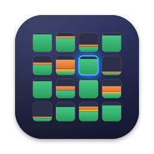
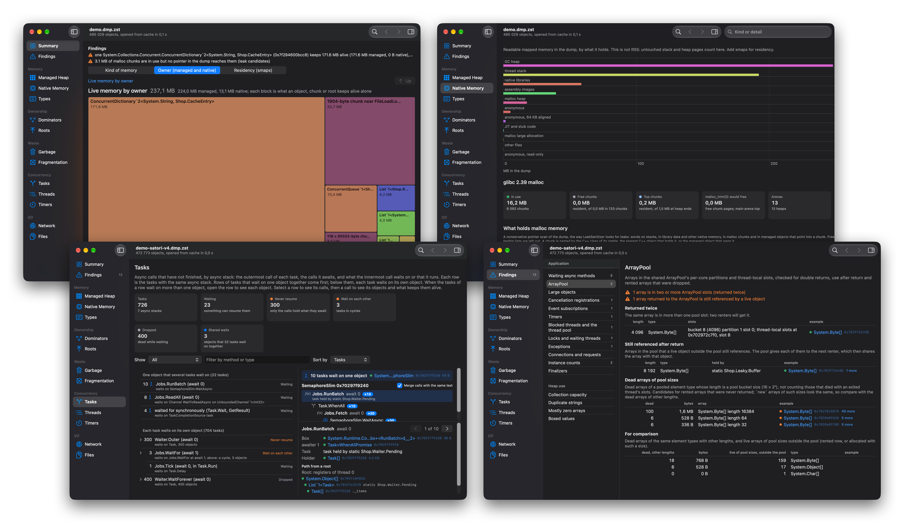

# Dotheap



#### Disclaimer 1
Dotheap is authored entirely with AI tools. Yelling at digital spirits is all you need.

#### Disclaimer 2
This tool can and will sometimes produce inaccurate numbers.  
A lot of its heuristics are tied to specific implementation details of .NET's standard library, GC internals and Roslyn's async state machine layout. Some features are speculative estimations. Providing a _useful_ diagnostic is more important than being absolutely accurate.

## Description

So what is Dotheap?
Dotheap is a mixed-mode (managed + native) heap snapshot analysis tool for .NET 10 applications which supports both standard (WKS/SVR) and [Satori](https://github.com/VSadov/Satori) GC families.



Ever had to respond to an incident or troubleshoot abnormal memory usage or application state at a point in time only to waste hours, thinking "it's just some 6.7 GiB of RAM, why is it so hard to tell what's using it?". Dotheap is made to put this to a definitive end.

Dotheap does:
- Complete accounting of _both_ managed and native memory usage in a unified memory graph
- Diagnosing managed<->native memory leaks
- Reconstructing async call chains, dependencies, task leaks and async deadlocks
- Working with larger-than-memory heaps (and larger than free disk space too)
- Speculative fragmentation source analysis
- Glibc malloc pointer ownership analysis
- Dead object graph analysis
- Detecting shared array pool use-after-return and double-return
- Automatic runtime symbol downloading and management (ever fought with .NET SoS?)
- And more

Dotheap comes in two forms: CLI and Viewer application both using the shared `heap-core`.

The CLI runs on Linux, macOS and Windows. It is designed to be agent-friendly but even a human operator may find it useful, should the need arise.

The Viewer is a native macOS application which mainly exists for recreational purposes of a human operator. In the age of increasing automation, it is designed to evoke a nostalgic feeling of digging through navigation menus, heap information records and "aha, so that's what the problem is" without leaving unnecessary guesswork afterwards.

## (Almost) pauseless live heap snapshots 

_On Linux systems_, Dotheap supports _live_ heap snapshots.  
It implements VM live migration style memory capture mechanism which replaces standard "request .NET application over IPC to suspend itself and (slowly) write the raw dump to disk" incompatible with production applications serving live traffic or just actively running.  

This means you can use `dotheap dump` on live applications with huge heaps with almost no interruption (typical suspension duration is within 250-25ms depending on heap size and modified memory pages).

In such scenarios, `dotheap dump` writes `dmp.zst` and `smaps.zst` files. The dump is written as 256KiB blocks compressed into ZSTD frames. CLI and Viewer then work directly on this format, indexing and caching produced analysis without ever fully decompressing potentially dozens of gigabytes of data.

## Install

- **macOS 15+:** `brew install --cask neon-sunset/tap/dotheap` builds the CLI and Viewer from
  source, installs `dotheap` on your PATH, and puts `Dotheap.app` in `/Applications`.
  Requires Xcode 16 or later; Homebrew installs Rust. Use `brew upgrade --cask dotheap` to update both.
- **Linux:** download a static x86_64 or aarch64 binary from the
  [releases page](https://github.com/neon-sunset/dotheap/releases). No runtime dependencies are required.
- **Windows:** download `dotheap-windows-x64.zip` from the releases page and extract `dotheap.exe`.
  No additional runtime or DLLs are required.

## CLI Walkthrough

```sh
dotheap summary core.dmp                # Memory totals, findings and next commands
dotheap types core.dmp                  # Types by retained, live or dead bytes
dotheap object core.dmp 0x7fa16480      # Fields, referrers and a path to a root
dotheap retained core.dmp 0x7fa16480    # Managed and native memory retained by an object
dotheap help                            # Commands and common options
dotheap help dump                       # Capture options, permissions and pauses
```

Start with `summary` and follow its `next` list. Each suggested command includes the address to
inspect. An address can point anywhere inside an object or malloc chunk. If it points elsewhere,
the error identifies the memory and suggests a suitable command.

An excerpt from the demo's `summary --limit 3` output:

```text
largest retainers: (376 more; raise --limit)
  retained   managed  native  count  example     name
  171.6 MB  171.6 MB     0 B      1  0x7fa16480  System.Collections.Concurrent.ConcurrentDictionary`2<System.String, Shop.CacheEntry>
   42.2 MB   38.2 MB  4.0 MB      1  0x7fc09018  static fields (System.Object[])
   10.4 MB   10.4 MB     0 B      1  0x7fa143a8  System.Collections.Concurrent.ConcurrentQueue`1<Shop.LogRow>
```

To inspect the large cache and list its entries:

```sh
dotheap instances core.dmp CacheEntry --live --sort retained
dotheap retained core.dmp 0x7fa16480 --limit 0
dotheap object core.dmp 0x7fa16480 --json
```

`instances` accepts an exact type name or a name fragment. Quote names that contain spaces or
shell characters. Use `--match` to filter type names and `--text` to filter instances by their
contents or identifying string fields; `dotheap help <command>` lists the options each accepts.

## Managed and native ownership

A managed cache can hold native buffers through `SafeHandle` or `IntPtr` fields. Native code can
keep managed objects alive through GC handles. Dotheap follows both directions in one graph, so
root paths and retained sizes can include managed objects and native allocations.

Retained size is the memory reachable only through a particular object or allocation in that
graph. It does not predict an immediate drop in RSS. A pointer establishes a reference, not proof
of ownership: conservative scans can include stale pointers or miss encoded ones. Native allocation
analysis requires Linux/glibc; see the [analysis reference](docs/analysis.md#managed-and-native-ownership)
for reference rules, native-root categories and chunk naming.

## Capture a process

```sh
dotheap ps
dotheap dump 4321 --out core.dmp.zst
dotheap summary --pid 4321
```

Process discovery and capture are supported on Linux and macOS. `ps` lists running processes
and identifies .NET applications by diagnostics sockets in `TMPDIR` and `/tmp`. Processes with
diagnostics disabled appear among other applications. `--pid` captures first, then runs the
selected analysis command. `--out`, `--pause` and `--offline` also apply.

### Live Linux capture

By default, Linux capture copies memory while the process runs, then stops its threads to read
registers and finish the copy. There can be several brief stops before the final one. Busy
processes, large heaps, low memory and slow storage can still produce long pauses. Other processes
can continue changing shared memory while the target is stopped.

Capture needs ptrace access: usually root, or the target user with suitable process permissions
and `kernel.yama.ptrace_scope`. If live capture is unavailable or fails, Dotheap stops. It never
switches to runtime capture automatically; that requires `--offline` and has the longer pause below.

Capture fails if the process exits or replaces its address space before the final copy, or a
required memory or register read fails at the final stop. Deleting a mapped file does not by itself
make its memory unreadable. Deleted mappings are identified by `files` and in the Viewer.

### macOS capture

On Apple silicon, Dotheap captures a kernel copy-on-write snapshot and writes it directly as
independent compressed frames. The process continues while the dump is written. If the kernel
cannot create a snapshot, the Viewer offers to pause the process for capture. The CLI requires
`--pause` for this fallback; it never switches automatically. Cancellation or failure resumes
the process and removes the unfinished output. Closing the capturing process also releases
its suspension token. Other processes can still change shared memory.

Direct capture needs macOS debugger access. The packaged CLI and Viewer carry the debugger
entitlement; protected applications may still deny access, even as root. Translated x86 processes
are not supported. Device I/O mappings are omitted because reading them can affect the device.
The Viewer separates .NET applications and other applications in the process list. Native macOS
analysis currently shows mappings and stacks; Darwin malloc chunk analysis is not implemented.
The Viewer sorts processes by physical footprint by default and can also sort by PID, program
or user. **Pause for .NET runtime dump** selects .NET
diagnostics instead of a kernel snapshot.

Capture reads and compresses memory blocks in parallel. Full dumps include readable shared-library
mappings as well as private memory, so capture size can substantially exceed the process's physical
footprint. Captures include region residency measured before reading memory and the process's
physical footprint measured just before the snapshot.

### Runtime capture

With `--offline`, Dotheap asks the .NET runtime to write a full dump. **The process stays paused for the entire raw-dump write.** For large heaps,
this makes runtime capture impractical
on services that must keep serving traffic.

```sh
dotheap dump 4321 --offline --out core.dmp.zst
```

Run as the target user or root. The runtime writes as the target user, who must have permission
to write to the output directory. Compression starts after the process resumes. A filename without
`.zst` keeps the raw dump. If compression or publication fails, the error gives the raw dump's
recovery path.

### Output and resource use

`--out` (`-o`) accepts a filename or an existing directory, relative to Dotheap's working directory.
A directory gets `<program>-<pid>-<time>.dmp.zst`. The default is the cache's `live` directory.
When root requests a runtime dump of another user's process, the default is a new directory in
`/tmp` owned by that user. Existing output files are never replaced.

Live capture always writes Zstandard data. Progress, disk use and pause times go to stderr;
stdout receives the completed path, or `{"dump":"<path>"}` with `--json`. Linux capture also saves
smaps beside the dump for [resident-memory analysis](#resident-memory).

Live capture needs space for the compressed output and temporary copies. It checks free space
periodically and stops below 2 GiB available to non-root users. Pages copied at the final stop
can spill to disk when memory is limited, which lengthens the pause. Runtime capture needs space
for both the full raw dump and its compressed output until compression finishes.

Dotheap makes itself a preferred OOM victim, but cannot guarantee the target survives memory
pressure. Temporary files can remain after a forced termination on filesystems without unnamed
file support. See [Live capture implementation](docs/capture.md) for the copying procedure,
resource limits and cleanup behaviour.

## Compatibility

| Dump format | Architectures | Managed heaps |
|---|---|---|
| Linux ELF core | x64, arm64 | Satori; stock CoreCLR workstation and server GC with regions |
| macOS Mach-O core | arm64 | Satori; stock CoreCLR workstation and server GC with segments |

Use a full dump from `dotheap dump`, `dotnet-dump collect --type Full`, a kernel core or `gcore`.
The analysis host can differ from the dump's platform: for example, read a Linux dump on macOS.
The Windows CLI also reads these formats; Windows minidumps are not supported.

.NET and ASP.NET Core **10.0.1–10.0.13** are supported, including intermediate patch releases.
Versions outside this range open with warnings in the CLI and Viewer. The summary identifies the
runtime, .NET libraries and ASP.NET Core versions. [versions.rs](crates/heap-core/src/versions.rs)
defines the range; [Development](docs/development.md#net-version-compatibility) records the source
checks and dump tests behind it.

Satori heap layouts are selected by structural checks against region headers, rather than a
runtime-version allowlist. An ambiguous or unsupported layout stops analysis. The summary reports
which layout matched; the [Satori reference](docs/analysis.md#satori-layouts-and-region-contents)
lists supported layouts and explains region contents. .NET library and ASP.NET Core version
warnings still apply to Satori dumps.

Native-only Linux processes get mapping, thread and glibc malloc analysis. This includes C, C++
and Rust programs using glibc's allocator. Go's managed heap is outside malloc, so its dumps
primarily provide mappings and stacks. Musl and other allocators have no chunk analysis; macOS
malloc zones are not walked. Glibc analysis has been verified on 2.36 and 2.39.

### Symbols and metadata

Full runtime dumps normally include assembly images; kernel cores and `gcore` can omit them.
Supply missing app or runtime assemblies with repeatable `--dlls` options:

```sh
dotheap summary core.dmp --dlls ./app --dlls ./runtime
dotheap symbols core.dmp
```

Directories are searched recursively. Missing metadata is listed in the summary; object sizes
and managed liveness do not depend on type names. Matching portable PDBs, embedded or in a
`--dlls` directory, supply await and callback source locations.

`symbols` downloads .NET runtime debug files for Linux dumps from Microsoft's symbol server and
caches them by build ID. The Viewer downloads them automatically unless **File > Download Runtime
Symbols When a Dump Opens** is disabled. Cached symbols are reused. Findings run without waiting
for downloads; analysis refreshes when new symbols arrive. Large debug files can take several minutes
to download in the background.

Satori and other custom runtimes need debug files from their own builds, such as `libcoreclr.so.dbg`,
in a `--dlls` directory. Native binaries are also sought at their recorded paths. Dotheap accepts
a binary only if its build ID matches, or its first page matches when no build ID is available.

## Commands

| Command | What it shows |
|---|---|
| `summary` | Memory by kind, managed and malloc totals, findings, warnings, large retainers and commands to run next. |
| `types`, `instances <type>` | Types by retained/live/dead bytes or count; instances by retained size or object size, with identifying strings and reachability filters. |
| `object <address>`, `retained [<address>]` | Fields, contents, referrers and a root path; managed and native dominator children grouped by type. Without an address, `retained` lists root sources. |
| `search <text>` | Matching findings, report rows, methods, callbacks, fields, types and native groups; an address identifies the memory there. |
| `native`, `chunk <address>` | glibc malloc memory by type or referrer and library; size distributions with `--group`, individual allocations, arena heaps, and reference evidence. |
| `malloc-arenas` | Free and top-chunk memory by attached thread count; glibc parameters; estimated effects of `malloc_trim(0)`, trim/arena tunables and restart. |
| `regions [<address>]`, `handles` | Regions grouped by generation, queue or size; one region and its types; GC handles by kind and target type. |
| `memory`, `bytes <address>`, `find <value>` | Memory by kind; a hex dump with resolved 8-byte pointers; every detected occurrence of an 8-byte value in fields, chunks, stacks or other memory. |
| `garbage`, `fragmentation` | Dead objects and the structures they retain; dead objects and unused committed space, attributed to GC rules and surviving objects. GC storage, objects pending finalization and unparsed bytes are excluded from fragmentation attribution. |
| `tasks [<address>]`, `async` | Running, queued and waiting calls by async stack. An address selects calls sharing an awaited object, their call tree, state-machine fields and root paths. |
| `threads [<tid>]`, `stacks` | Thread functions and estimated frames; a merged tree of managed frames with each group's running or waiting state. |
| `network`, `connections` | Sockets, endpoints, descriptors, owners and pending I/O; Kestrel/HttpClient requests; pools and socket engines. `connections` focuses on active requests and queued work. |
| `files` | Managed handles with path, access, position, buffered bytes, pending I/O and owner; native C++ paths and estimated descriptors; mapped and deleted files. |
| `timers` | Timer sources, callback methods or awaiting calls, owners, periods and relative ages. |
| `collections`, `strings`, `zero-arrays`, `boxed`, `finalizable` | Collection capacity, duplicate strings, mostly zero arrays, boxed values and finalizer states. |
| `findings` | Heap integrity, potential leaks, blocked work and inefficient memory use, with commands for detailed reports. |
| `verify` | Invalid object, type and runtime structures, with field addresses and values. Works without the reference graph. |
| `ps`, `dump <pid>` | Discover local processes or capture one. Linux uses live capture; Apple silicon macOS uses a kernel snapshot. Runtime capture requires `--offline`. |
| `cache`, `symbols` | List or remove analysis caches; download matching .NET runtime symbols. |
| `report` | A full text report, also available as `dotheap core.dmp`. Uses `--top` rather than `--limit`; see `dotheap help report`. |

Use `dotheap help <command>` for arguments, options and interpretation. Every analysis command takes
`<core>` before its command-specific arguments, or `--pid <pid>` to capture first.

## Findings

`findings` lists potential problems; `summary` includes a ranked overview.
Run a command below to inspect the evidence. The Viewer links findings to the relevant objects
and detailed views. See the [analysis reference](docs/analysis.md) for interpretation and limits.

| Command | What to investigate |
|---|---|
| `verify` | Corrupt MethodTables, object sizes, GC descriptors, references and runtime links. Missing memory is reported separately. See [heap integrity](docs/analysis.md#heap-integrity) for scope and limits. |
| `async`, `blocked`, `locks` | Shared waits, abandoned calls, dependency cycles, blocked threads and possible starvation or deadlocks. Frames and waiters are inferred; a snapshot cannot measure wait duration. |
| `arraypool` | Double returns, references to returned arrays, and possible missed returns. Directly allocated arrays can resemble missed returns. |
| `large-objects` | Large allocations by type, dead objects awaiting collection and unused space in their regions. |
| `cancellation`, `events` | Callback registrations or subscriptions that retain objects longer than intended. |
| `timers` | Timer callbacks or awaiting calls, owners and periods. Ages are relative to other timers in the dump, not capture time. |
| `instance-counts` | High counts of commonly shared or disposable types, grouped by owner. |
| `exceptions` | Repeated throw sites, retained exceptions and unobserved faulted tasks. |
| `connections`, `network`, `files` | Requests, queues, sockets, file handles, pending I/O and mapped or deleted files. Native file descriptors are estimates. |
| `finalizer-backlog`, `native-held-by-dead` | Native memory waiting for finalizers or referenced only by dead managed objects. Stale pointers can resemble leaks. |
| `finalizable` | Registered, suppressed, resurrected, pending and dead objects of finalizable types. |

Findings identify evidence to inspect. A high count or an unreferenced allocation alone does not
prove a leak. Async analysis targets the .NET 10 state-machine model, not .NET 11 runtime async.

## macOS viewer

Open `.dmp` or `.zst` files from Finder or **File > Open Dump…**. Each dump has its own window,
navigation and selections. Opening the same dump again brings its window forward. Opening an
smaps file selects the dump beside it.

Select a managed object or native allocation to inspect it in the sidebar. Dominators and Roots
include both kinds, with links to their references and root paths. Native Memory separates allocation
groups, malloc heaps, mappings and overview statistics so each table has its own scrolling area.
Search (⇧⌘F) finds types, methods,
callbacks, findings, native classes, pages and addresses. Back and Forward (⌘[ and ⌘], or the
mouse buttons) restore earlier pages and selections.

To launch a specific view in a separate process:

```sh
open -n Dotheap.app --args -dump core.dmp
open -n Dotheap.app --args -dump core.dmp -section "Managed Heap" -heapView "Region Map" -region 0x44200000
open -n Dotheap.app --args -dump core.dmp -section Threads -threadsView Locks
```

Other startup options include `-smaps <file>`, `-type <name>`, `-object <address>`, `-task <address>`,
`-finding <check>`, `-search <text>`, `-networkView Requests` and `-filesView "Mapped files"`.

## Resident memory

Dotheap captures on macOS include residency data in the dump. The Residency view shows the
physical footprint separately from resident mappings: shared pages can occur in several mappings,
so their sum is not the process's physical footprint. Compressed and swapped pages are reported
together. macOS does not supply Linux transparent-huge-page statistics.

For other dumps, supply `/proc/<pid>/smaps` on Linux or `vmmap -wide <pid>` output on macOS,
taken close to the dump. Residency cannot be reconstructed from memory contents alone:

```sh
dotheap summary core.dmp --smaps core.smaps
```

`.gz` and `.zst` are accepted. Without `--smaps`, Dotheap tries `<name>.smaps.zst`, `.smaps.gz`, then
`.smaps` beside `<name>.dmp.zst` or `<name>.dmp`. Linux capture saves smaps after the target resumes.

With matching residency data, process totals and memory grouped by kind, stack, malloc heap and
mapped file use RSS. On mismatch, a warning explains why, those views use dump estimates, and the
Residency view still shows the supplied data. Zero-filled heap pages make estimates uncertain:
they can be resident after writes or because a huge page backs them.

Matching checks reject obvious differences; they cannot prove the files describe the same instant.
Residency can change between captures. The [analysis reference](docs/analysis.md#residency-and-storage)
explains the checks and estimates.

## Scripts and agents

- Use `--json` for structured output. Byte counts are numbers of bytes; addresses are `"0x..."`
  strings. JSON text has no table-cell limit, although preview fields can still be abbreviated.
  Text tables can shorten cells over 80 characters except in the last column. Human-readable
  sizes use powers of 1024.
- `--limit` defaults to 20 rows per list; 0 returns all rows. A shortened JSON list has a sibling
  `<name>Omitted` count. Check it before treating a list as complete.
- Results go to stdout; processing notices, capture progress and warnings go to stderr.
  `--progress` adds processing phases and durations. Exit status 0 means success, 1 means failure,
  and 2 means invalid arguments. Discard stdout from a failed command.
- Start with `summary` and follow its `next` commands, as in the [walkthrough](#cli-walkthrough).
  Use named commands for subsequent queries; `report` is text-only.
- Rows use deterministic ordering and tie-breakers. Keep the dump available even after analysis;
  some details are read from it on demand.

```sh
dotheap summary core.dmp --json > summary.json
dotheap instances core.dmp CacheEntry --live --limit 0 --json > entries.json
dotheap dump 4321 --out core.dmp.zst --json > capture.json
```

## Cache

The first command processes the dump; later commands reuse its analysis cache. Findings and detailed
reports are saved when first requested. The cache identifies the dump by its path and file identity;
replacing the dump invalidates its cached analysis.

| Platform | Default cache root |
|---|---|
| macOS | `~/Library/Caches/dotheap` |
| Linux | `$XDG_CACHE_HOME/dotheap`, or `~/.cache/dotheap` |
| Windows | `%LOCALAPPDATA%\dotheap`, or `%TEMP%\dotheap` if `LOCALAPPDATA` is unset |

`dotheap cache` prints the actual root. Object and reference data use files the OS can page out,
but working memory still depends on object counts, references and the requested analysis.

Dumps written by Dotheap are read directly as compressed blocks. Other `.zst` files may need a
second compressed copy in the cache; allow space comparable to the compressed source. Random
reads can also expand data into a temporary sparse file. Its disk use grows with the nonzero
pages accessed and can approach the expanded dump size. The file is removed when it is no longer
in use. See [Residency and storage](docs/analysis.md#residency-and-storage) for the storage paths.
Zstandard support is built in; analysis needs no installed `zstd` command.

The Viewer offers to convert dumps that require sequential decompression. Conversion writes
independent 256 KiB frames at compression level 3, using all available CPU cores.
**Replace Original** verifies a temporary converted file before atomically replacing the source,
then removes its obsolete compressed cache. **Keep Original…** saves a separate copy and copies
an adjacent memory map. Both options reuse valid object and reference cache files and need
temporary space for the compressed output. Cancellation or failure before replacement preserves
the original. Conversion streams directly to compressed output; it does not write a full raw dump.
**Open Original** uses the existing cache path. The suggestion can be disabled in Settings.

```sh
dotheap cache                         # Cached analyses, source paths and disk use
dotheap cache --delete missing        # Caches whose recorded source dump is missing
dotheap cache --delete '<folder>'     # One folder listed by dotheap cache
dotheap cache --delete all            # All analysis caches; preserves dumps and symbols
dotheap summary core.dmp --rebuild    # Process again in the default cache
```

`--cache <directory>` chooses a cache directory. `--no-cache` processes an uncompressed dump without
saving results; compressed dumps require a cache. The Viewer has **File > Cache**, **File > Process
Dump Again** and **File > Open Recent**. Deleting a cache makes the next open process the dump
again. Dumps and caches contain application data and can include credentials; keep them private.

## Build

The CLI and analysis core use Rust 1.94 or later. Build with a C compiler available for the bundled
compression and TLS dependencies. On Windows, use the MSVC Rust toolchain and Visual Studio C++
Build Tools.

```sh
cargo build --release --locked -p dotheap
target/release/dotheap help
```

The Viewer needs macOS 15+, Xcode 16 or later with Swift 6, and Python 3. The macOS build script
builds the CLI and Viewer, links the Rust core into the app, and signs both with the debugger
entitlement needed for direct capture:

```sh
scripts/build-macos.sh
open Dotheap.app
```

For a static Linux binary, install `musl-tools` and build on the target architecture:

```sh
rustup target add x86_64-unknown-linux-musl
CC=musl-gcc cargo build --release --locked -p dotheap --target x86_64-unknown-linux-musl
strip target/x86_64-unknown-linux-musl/release/dotheap
# On arm64, use aarch64-unknown-linux-musl in both paths.
```

These binaries also run on glibc distributions; the destination needs no musl installation.
Use a binary built for the destination's CPU architecture.

For a Windows binary with the C runtime linked statically, use an explicit target:

```powershell
cargo build --release --locked -p dotheap --target x86_64-pc-windows-msvc
target/x86_64-pc-windows-msvc/release/dotheap.exe help
```

See [Development](docs/development.md) for tests, real-dump comparisons, packaging and third-party
notices. [Swift and Rust interop](docs/interop.md) describes the Viewer's data access and ownership.

## License

Copyright (C) 2026 Arseniy Zlobintsev.

Dotheap is licensed under the [GNU Affero General Public License, version 3](LICENSE)
(`AGPL-3.0-only`). Third-party components retain their own licenses; see
[third-party notices](THIRD-PARTY-NOTICES.txt).

The Viewer provides both license documents in **Dotheap > About Dotheap**.
